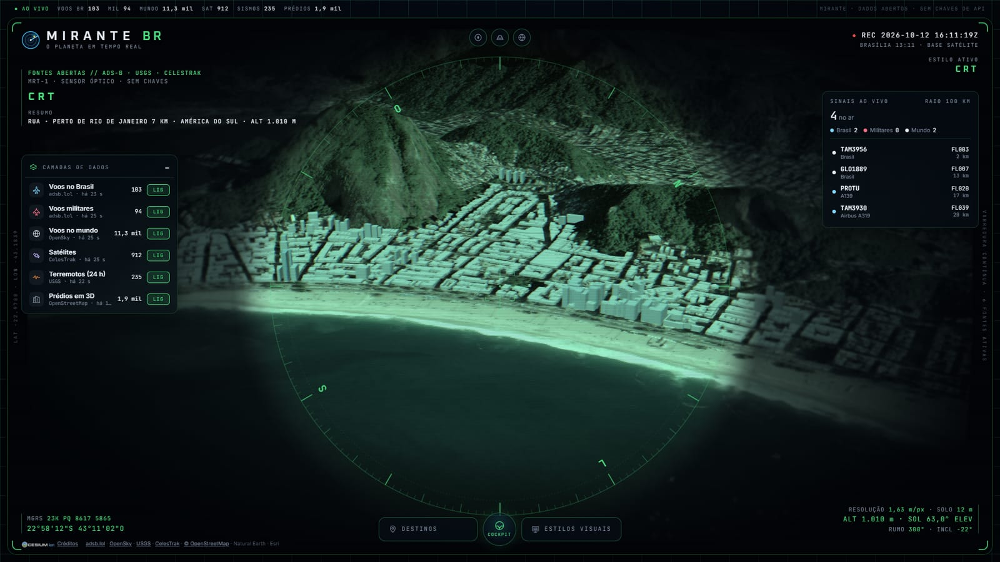

# Mirante

**O planeta ao vivo, só com dados abertos.** Um globo 3D no navegador, visto por uma
lente de satélite, com os aviões voando sobre o Brasil e o mundo, os terremotos das
últimas 24 horas, quase mil satélites em órbita e cidades brasileiras em 3D sobre o
relevo real.

**🔗 Ao vivo: [mirante-rho.vercel.app](https://mirante-rho.vercel.app)**


## O que dá para fazer

- ✈️ **Voos ao vivo**: os do Brasil com modelo e matrícula, os militares do mundo
  inteiro e milhares de aviões em todos os continentes. Entre uma atualização e outra
  cada avião segue andando, calculado pela velocidade e pelo rumo.
- 🧑‍✈️ **Cockpit**: embarque em qualquer avião ao vivo e veja em primeira pessoa, com fita
  de rumo, velocidade, altitude, razão de subida e os aviões ao redor. Dá para pular de
  um avião para outro e olhar em volta com as setas do teclado.
- 🏙️ **Cidades em 3D**: Fortaleza (Beira-Mar), São Paulo (Paulista) e Rio (Copacabana),
  com milhares de prédios do OpenStreetMap na altura certa, sobre os morros de verdade.
- 🛰️ **Satélites**: estações espaciais, GPS/Galileo/GLONASS/BeiDou, meteorológicos e o
  anel geoestacionário, com órbitas calculadas no navegador (SGP4). Dá para seguir a ISS
  e ver a próxima volta dela ao redor da Terra.
- 🌋 **Terremotos das últimas 24 h** no mundo todo, com uma onda animada nos mais fortes.
- 🎯 **Lente e HUD**: bússola que gira com a câmera, coordenadas MGRS, resolução em metros
  por pixel, elevação do Sol no ponto observado e um resumo do que está na lente
  ("PERTO DE FORTALEZA 10 KM · AMÉRICA DO SUL").
- 📡 **Sinais ao vivo**: quantos aviões há na área que você está vendo e os mais próximos.
- 🎥 **Estilos visuais** feitos com shaders: CRT, visão noturna, câmera térmica e noir.
- 🗺️ **Bases de mapa**: satélite, tático (escurecido), ruas (OpenStreetMap) e, com uma
  chave do Google, cidades fotorrealistas em 3D no mundo inteiro.
- 🇧🇷 Tudo em português, inclusive os nomes no mapa.


| Copacabana e os estilos visuais | Voos sobre o Brasil | Modo CRT |
| --- | --- | --- |
|  |  |  |

| Visão noturna | Seguindo a ISS |
| --- | --- |
|  |  |

## Stack

React 19 + TypeScript, Vite, [CesiumJS](https://cesium.com/platform/cesiumjs/) para o globo,
[satellite.js](https://github.com/shashwatak/satellite-js) para as órbitas e funções
serverless na Vercel. Testes com Vitest e CI no GitHub Actions.

## Como rodar

Precisa do [Node.js](https://nodejs.org) 22 ou mais novo. Funciona sem nenhuma chave.

```bash
git clone https://github.com/PauloMatiasxvs/mirante.git
cd mirante
npm install
npm run dev
```

Depois abra <http://localhost:5180>.

| Comando | O que faz |
| --- | --- |
| `npm run dev` | servidor de desenvolvimento (já inclui as rotas `/api/*`) |
| `npm run build` | checa os tipos e gera a versão de produção em `dist/` |
| `npm run preview` | serve a versão de produção localmente |
| `npm test` | roda os testes |
| `npm run data:buildings` | baixa de novo os prédios das cidades (OpenStreetMap) |
| `npm run data:basemap` | gera de novo os nomes e fronteiras (Natural Earth) |

### Configuração opcional

| Variável | Para quê | Onde |
| --- | --- | --- |
| `VITE_GOOGLE_MAPS_API_KEY` | Base "Fotorrealista": cidades em 3D do Google no mundo todo | Chave do Map Tiles API no Google Cloud. Ela vai para o navegador, então **restrinja ao domínio do site** |
| `OPENSKY_CLIENT_ID` e `OPENSKY_CLIENT_SECRET` | Voos do mundo no site publicado (a OpenSky bloqueia acesso anônimo vindo de servidores na nuvem) | Conta gratuita em opensky-network.org. Ficam só no servidor |

Localmente, coloque-as num arquivo `.env.local`; na Vercel, em *Settings → Environment
Variables*.

## Arquitetura

O Cesium é imperativo e roda fora do ciclo de render do React. Por isso o projeto separa
as duas coisas: um "motor" em `src/map` cuida do globo e publica o estado num store
pequeno, e os componentes React só leem esse estado (via `useSyncExternalStore`) e chamam
ações do motor.

```
api/                    funções serverless com cache: voos (Brasil, militares, mundo) e satélites
src/
  map/
    engine.ts           cria o viewer, luz, brilho, camadas; expõe ações e o store
    layers/             uma camada por fonte: voos, terremotos, satélites, prédios
    cockpit.ts          câmera em primeira pessoa num avião ao vivo
    telemetry.ts        o que a câmera está vendo (para a lente e o HUD)
    mapStyles.ts        bases de mapa (satélite, tático, ruas, fotorrealista)
    basemap.ts          nomes em português e fronteiras
    visionModes.ts      shaders CRT, visão noturna, térmica e noir
  components/           HUD: cabeçalho, camadas, sinais ao vivo, ficha, lente, barra, cockpit
  hooks/                ponte entre o store do motor e o React
  lib/                  funções puras (geografia, MGRS, formatação, tradução) e seus testes
  data/cities.json      cidades em 3D: área dos prédios e ângulo de câmera
public/data/            prédios, nomes e fronteiras já processados
scripts/                geram os arquivos de public/data
```

Milhares de aviões e quase mil satélites são desenhados como primitivas simples,
atualizadas em intervalos fixos, em vez de entidades interpoladas a cada quadro. Só as
estações espaciais e os voos do Brasil, que precisam de movimento suave, são entidades.

Para incluir outra cidade em 3D, adicione-a em `src/data/cities.json`, rode
`npm run data:buildings -- <id-da-cidade>` e crie o botão em `src/components/Dock.tsx`.

## Fontes de dados

| Dado | Fonte | Observação |
| --- | --- | --- |
| Voos no Brasil e militares | [adsb.lol](https://adsb.lol) | Rede comunitária de receptores ADS-B, dados sob ODbL |
| Voos no mundo | [OpenSky Network](https://opensky-network.org) | O servidor atualiza o retrato a cada 15 min |
| Terremotos | [USGS](https://earthquake.usgs.gov/earthquakes/feed/) | Feed público do Serviço Geológico dos EUA |
| Órbitas | [CelesTrak](https://celestrak.org) | Elementos orbitais (TLE), em cache por 2 h no servidor |
| Prédios | [OpenStreetMap](https://www.openstreetmap.org/copyright) | © colaboradores do OpenStreetMap, sob ODbL |
| Imagens | [Esri World Imagery](https://www.arcgis.com/home/item.html?id=10df2279f9684e4a9f6a7f08febac2a9) | Imagens de satélite com atribuição |
| Ruas | [OpenStreetMap](https://www.openstreetmap.org/copyright) | Tiles padrão do OSM |
| Nomes e fronteiras | [Natural Earth](https://www.naturalearthdata.com) | Domínio público; nomes em português |
| Relevo | [Esri World Elevation 3D](https://www.arcgis.com/home/item.html?id=7029fb60158543ad845c7e1527af11e4) | Modelo de elevação global |

A cobertura de voos depende dos receptores voluntários de cada região: no Brasil é maior
no Sudeste, em Brasília e em Fortaleza.

## Licença

[MIT](LICENSE) © 2026 PauloMatiasxvs
