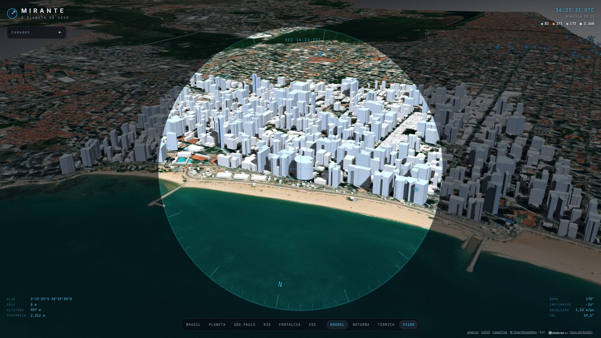
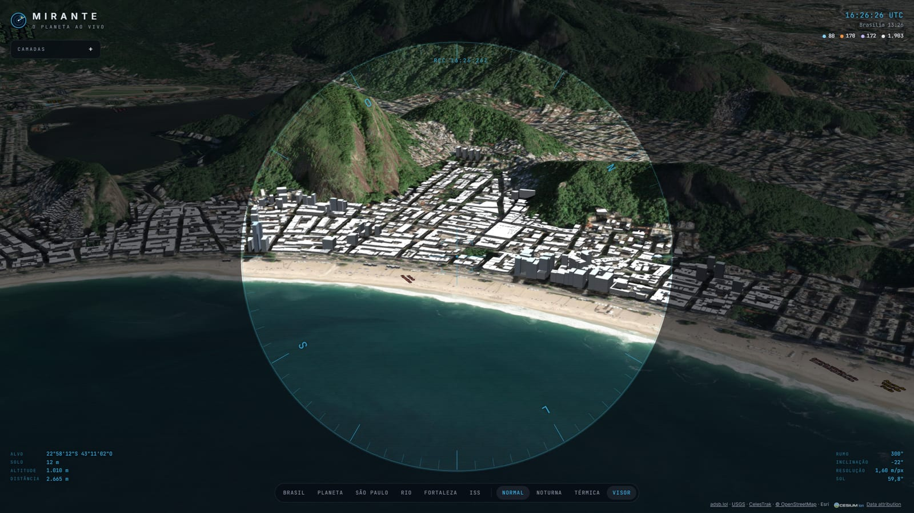
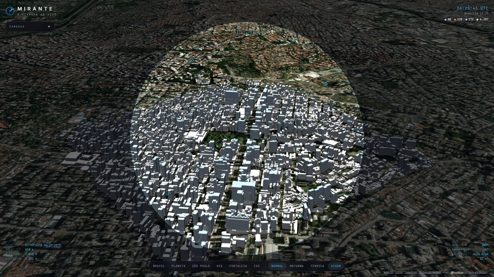
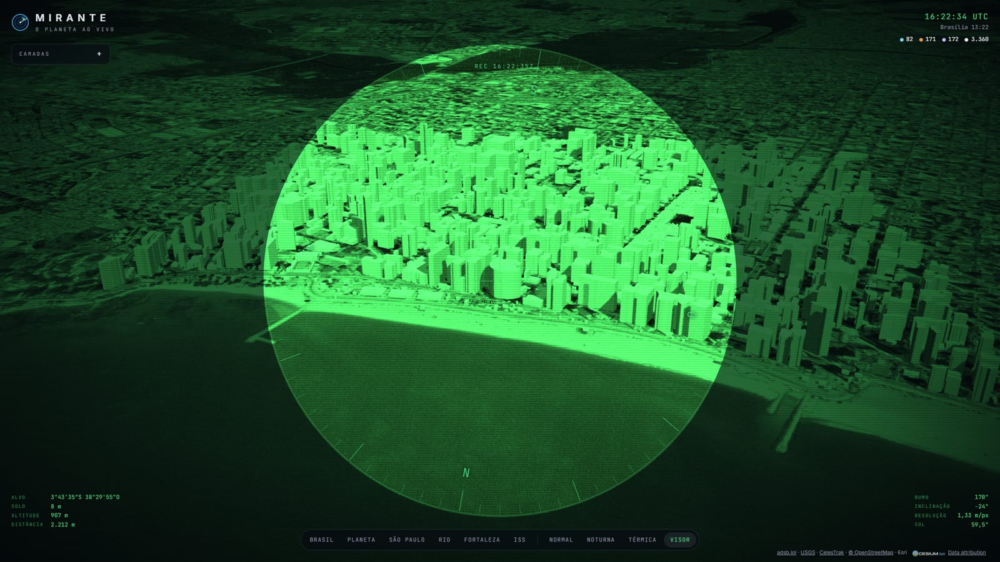
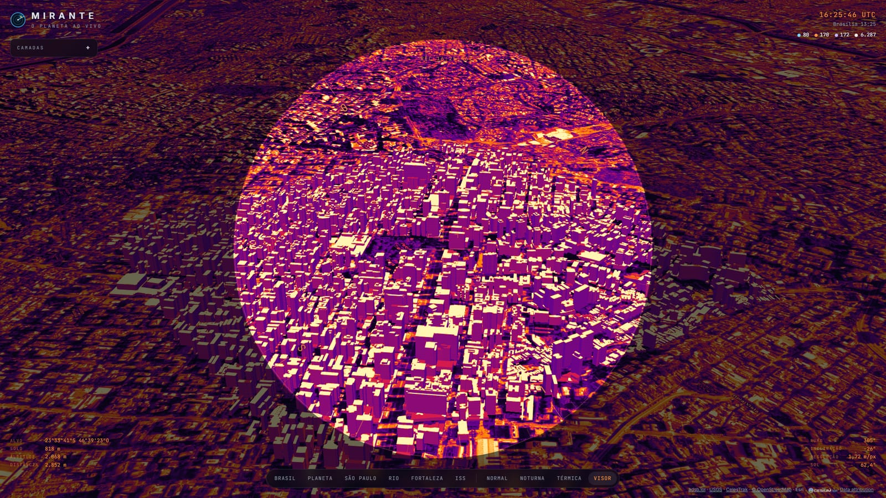
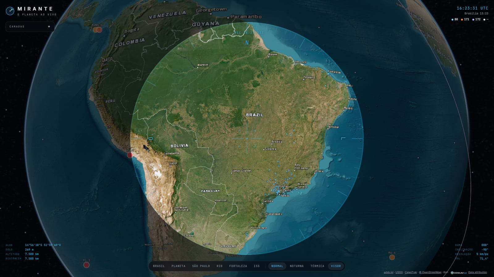
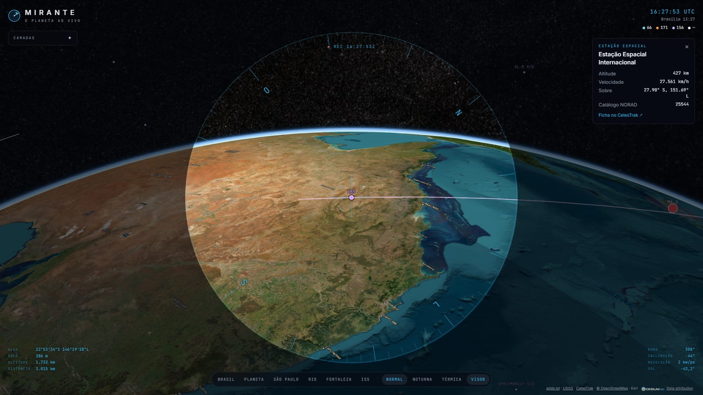

# Mirante

**O planeta ao vivo, só com dados abertos.** Um globo 3D no navegador, visto por um
visor de satélite, com os aviões voando sobre o Brasil, os terremotos das últimas
24 horas, os satélites em órbita e cidades brasileiras em 3D, com relevo real.



## O que dá para fazer

- 🏙️ **Cidades em 3D**: Fortaleza (Beira-Mar), São Paulo (Paulista) e Rio
  (Copacabana), com milhares de prédios do OpenStreetMap erguidos na altura
  certa, sobre o relevo de verdade dos morros e serras.
- 🛰️ **Visor de satélite**: bússola que gira com a câmera, mira e telemetria ao vivo
  do ponto observado: coordenadas, altitude do solo, distância, resolução em
  metros por pixel e a elevação do Sol naquele lugar e horário.
- ✈️ **Voos ao vivo no Brasil**: posição, altitude, velocidade, modelo e matrícula de
  cada avião. Entre uma atualização e outra o avião segue andando no mapa,
  calculado a partir da velocidade e do rumo.
- 🌋 **Terremotos das últimas 24 h** no mundo todo, com tamanho e cor pela magnitude
  e uma onda animada nos mais fortes.
- 🚀 **Satélites e estações espaciais**: as órbitas são calculadas no próprio navegador
  (modelo SGP4). Dá para seguir a ISS e ver a próxima volta dela ao redor da Terra.
- 🎥 **Modos de visão** feitos com shaders: visão noturna e câmera térmica.
- 🖱️ Clique em qualquer avião, terremoto ou satélite para abrir uma ficha com os detalhes.

| Copacabana com os morros | Avenida Paulista | Visão noturna |
| --- | --- | --- |
|  |  |  |

| Câmera térmica | Voos sobre o Brasil | Seguindo a ISS |
| --- | --- | --- |
|  |  |  |

## Como rodar

Precisa só do [Node.js](https://nodejs.org) 20 ou mais novo. Não há dependências
para instalar e nenhuma chave de API.

```bash
git clone https://github.com/PauloMatiasxvs/mirante.git
cd mirante
npm start
```

Depois abra <http://localhost:5180>.

## Como funciona

```
public/                 site estático (HTML, CSS e JavaScript puro)
  js/main.js            monta o globo, a luz, as sombras e liga os controles
  js/camadas/           uma camada por fonte de dados (voos, terremotos, satélites, prédios)
  js/visor.js           visor de satélite e telemetria
  js/modos.js           shaders de visão noturna e térmica
  js/cidades.js         cidades em 3D: área dos prédios e ângulo de câmera
  dados/                prédios de cada cidade, já processados
api/flights.js          rota que busca os voos (o adsb.lol não libera CORS)
scripts/                baixar-predios.mjs atualiza os prédios a partir do OpenStreetMap
server.mjs              servidor local sem dependências
```

Para incluir outra cidade em 3D, adicione-a em `public/js/cidades.js`, rode
`node scripts/baixar-predios.mjs <cidade>` e crie o botão em `index.html`.

O globo usa o [CesiumJS](https://cesium.com/platform/cesiumjs/) e as órbitas usam o
[satellite.js](https://github.com/shashwatak/satellite-js), ambos carregados por CDN.

### Publicar na Vercel

O projeto já está pronto para a [Vercel](https://vercel.com): a pasta `public/` vira o
site e `api/flights.js` vira uma função serverless. Basta importar o repositório.

## Fontes de dados

| Dado | Fonte | Observação |
| --- | --- | --- |
| Voos | [adsb.lol](https://adsb.lol) | Rede comunitária de receptores ADS-B, dados sob ODbL |
| Terremotos | [USGS](https://earthquake.usgs.gov/earthquakes/feed/) | Feed público do Serviço Geológico dos EUA |
| Órbitas | [CelesTrak](https://celestrak.org) | Elementos orbitais (TLE), guardados em cache por 2 h |
| Prédios | [OpenStreetMap](https://www.openstreetmap.org/copyright) | © colaboradores do OpenStreetMap, sob ODbL |
| Imagens | [Esri World Imagery](https://www.arcgis.com/home/item.html?id=10df2279f9684e4a9f6a7f08febac2a9) | Imagens de satélite com atribuição |
| Relevo | [Esri World Elevation 3D](https://www.arcgis.com/home/item.html?id=7029fb60158543ad845c7e1527af11e4) | Modelo de elevação global |

A cobertura de voos depende dos receptores voluntários de cada região: é maior no
Sudeste, em Brasília e em Fortaleza.

## Licença

[MIT](LICENSE) © 2026 PauloMatiasxvs
