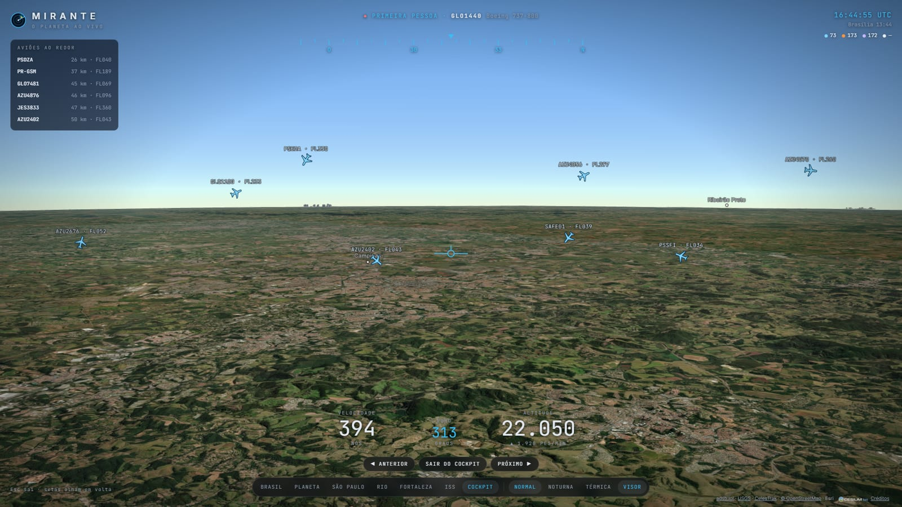

# Mirante

**O planeta ao vivo, só com dados abertos.** Um globo 3D no navegador, visto por um
visor de satélite, com os aviões voando sobre o Brasil, os terremotos das últimas
24 horas, os satélites em órbita e cidades brasileiras em 3D, com relevo real.


## O que dá para fazer

- 🏙️ **Cidades em 3D**: Fortaleza (Beira-Mar), São Paulo (Paulista) e Rio
  (Copacabana), com milhares de prédios do OpenStreetMap erguidos na altura
  certa, sobre o relevo de verdade dos morros e serras.
- 🛰️ **Visor de satélite**: bússola que gira com a câmera, mira e telemetria ao vivo
  do ponto observado: coordenadas, altitude do solo, distância, resolução em
  metros por pixel e a elevação do Sol naquele lugar e horário.
- ✈️ **Voos ao vivo no Brasil**: posição, altitude, velocidade, modelo e matrícula de
  cada avião. Entre uma atualização e outra o avião segue andando no mapa,
  calculado a partir da velocidade e do rumo.
- 🧑‍✈️ **Cockpit**: embarque num avião ao vivo e veja em primeira pessoa, com fita de
  rumo, velocidade, altitude, razão de subida e a lista dos aviões ao redor. Dá para
  pular de um avião para outro e olhar em volta com as setas do teclado.
- 🌋 **Terremotos das últimas 24 h** no mundo todo, com tamanho e cor pela magnitude
  e uma onda animada nos mais fortes.
- 🚀 **Satélites e estações espaciais**: as órbitas são calculadas no próprio navegador
  (modelo SGP4). Dá para seguir a ISS e ver a próxima volta dela ao redor da Terra.
- 🎥 **Modos de visão** feitos com shaders: visão noturna e câmera térmica.
- 🖱️ Clique em qualquer avião, terremoto ou satélite para abrir uma ficha com os detalhes.
- 🇧🇷 Tudo em português, inclusive os nomes no mapa.



| Copacabana com os morros | Avenida Paulista | Visão noturna |
| --- | --- | --- |
|  |  |  |

| Câmera térmica | Voos sobre o Brasil | Seguindo a ISS |
| --- | --- | --- |
|  |  |  |

## Stack

React 19 + TypeScript, Vite, [CesiumJS](https://cesium.com/platform/cesiumjs/) para o globo e
[satellite.js](https://github.com/shashwatak/satellite-js) para as órbitas. Testes com Vitest e
CI no GitHub Actions. Nenhuma chave de API.

## Como rodar

Precisa do [Node.js](https://nodejs.org) 22 ou mais novo.

```bash
git clone https://github.com/PauloMatiasxvs/mirante.git
cd mirante
npm install
npm run dev
```

Depois abra <http://localhost:5180>.

| Comando | O que faz |
| --- | --- |
| `npm run dev` | servidor de desenvolvimento (já inclui a rota `/api/flights`) |
| `npm run build` | checa os tipos e gera a versão de produção em `dist/` |
| `npm test` | roda os testes |
| `npm run data:buildings` | baixa de novo os prédios das cidades (OpenStreetMap) |
| `npm run data:basemap` | gera de novo os nomes e fronteiras (Natural Earth) |

## Arquitetura

O Cesium é imperativo e roda fora do ciclo de render do React. Por isso o projeto separa
as duas coisas: um "motor" em `src/map` cuida do globo e publica o estado num store
pequeno, e os componentes React só leem esse estado (via `useSyncExternalStore`) e chamam
ações do motor.

```
api/flights.ts          função serverless: busca os voos no adsb.lol (que não libera CORS)
src/
  map/
    engine.ts           cria o viewer, luz, sombras, camadas; expõe ações e o store
    layers/             uma camada por fonte: voos, terremotos, satélites, prédios
    cockpit.ts          câmera em primeira pessoa num avião ao vivo
    telemetry.ts        o que a câmera está vendo (para o visor)
    basemap.ts          nomes em português e fronteiras
    visionModes.ts      shaders de visão noturna e térmica
  components/           interface: barra, gaveta de camadas, ficha, visor, HUD do cockpit
  hooks/                ponte entre o store do motor e o React
  lib/                  funções puras (geografia, formatação, tradução) e seus testes
  data/cities.json      cidades em 3D: área dos prédios e ângulo de câmera
public/data/            prédios, nomes e fronteiras já processados
scripts/                geram os arquivos de public/data
```

Para incluir outra cidade em 3D, adicione-a em `src/data/cities.json`, rode
`npm run data:buildings -- <id-da-cidade>` e crie o botão em `src/components/Dock.tsx`.

### Publicar na Vercel

Importe o repositório na [Vercel](https://vercel.com): ela detecta o Vite, publica o `dist/`
e transforma `api/flights.ts` numa função serverless.

## Fontes de dados

| Dado | Fonte | Observação |
| --- | --- | --- |
| Voos | [adsb.lol](https://adsb.lol) | Rede comunitária de receptores ADS-B, dados sob ODbL |
| Terremotos | [USGS](https://earthquake.usgs.gov/earthquakes/feed/) | Feed público do Serviço Geológico dos EUA |
| Órbitas | [CelesTrak](https://celestrak.org) | Elementos orbitais (TLE), guardados em cache por 2 h |
| Prédios | [OpenStreetMap](https://www.openstreetmap.org/copyright) | © colaboradores do OpenStreetMap, sob ODbL |
| Imagens | [Esri World Imagery](https://www.arcgis.com/home/item.html?id=10df2279f9684e4a9f6a7f08febac2a9) | Imagens de satélite com atribuição |
| Nomes e fronteiras | [Natural Earth](https://www.naturalearthdata.com) | Domínio público; nomes de países, cidades e mares em português |
| Relevo | [Esri World Elevation 3D](https://www.arcgis.com/home/item.html?id=7029fb60158543ad845c7e1527af11e4) | Modelo de elevação global |

A cobertura de voos depende dos receptores voluntários de cada região: é maior no
Sudeste, em Brasília e em Fortaleza.

## Licença

[MIT](LICENSE) © 2026 PauloMatiasxvs
